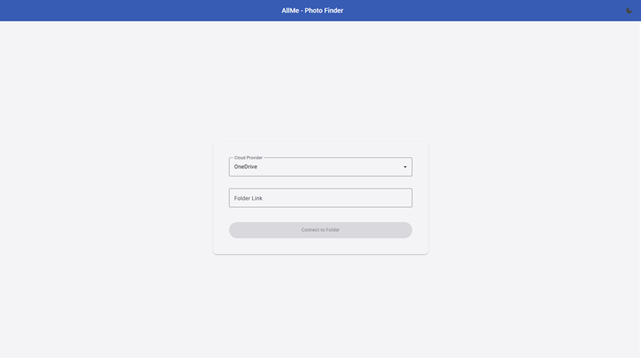
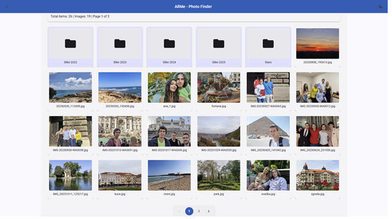
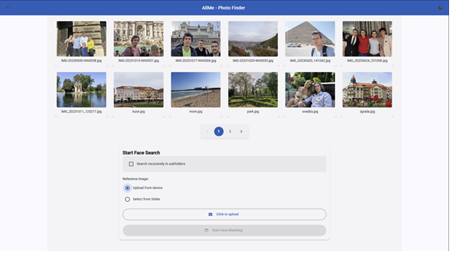
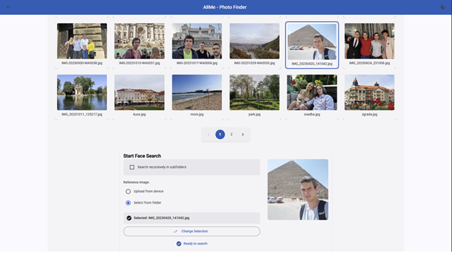
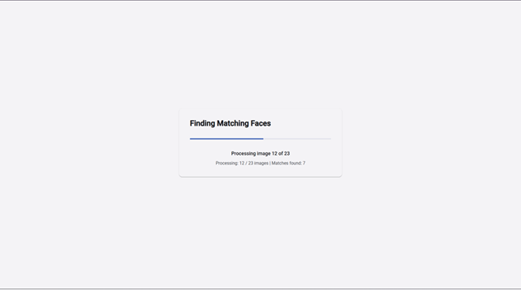
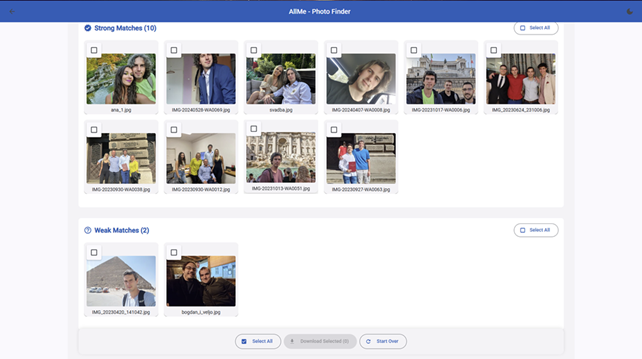

# AllMe - Find yourself in large shared drives 📸

<div align="center">

[](https://go.dev/)
[](https://angular.dev/)
[](https://python.org/)
[](https://docker.com/)

</div>

---

## 🔍 Overview

**AllMe** is a web application that uses facial recognition to help you find photos of yourself across your cloud storage. Upload a reference photo, connect your OneDrive or Google Drive, and let AI do the heavy lifting—no more endless scrolling through thousands of vacation photos.

Results are categorized by match confidence based on facial similarity scores, and you can easily download your matches in bulk. The application supports recursive folder searches and batch processing of large photo collections.

---

## 📸 Screenshots

<div align="center">

<p float="left">
  
  
</p>

<p float="left">
  
  
</p>

<p float="left">
  
  
</p>

</div>

---

## ✨ Features

### 🎯 Core Capabilities

- **Facial Recognition** - Advanced AI-powered face detection and matching using deep learning models
- **Multi-Provider Support** - Works seamlessly with OneDrive and Google Drive
- **Batch Processing** - Scan hundreds or thousands of photos efficiently with progress tracking
- **Confidence Scoring** - Results separated into strong and weak matches based on similarity scores
- **Recursive Search** - Search through nested folders and subdirectories
- **Bulk Download** - Download all matched photos or selected ones in a single operation
- **Session Management** - Maintains search state for easy navigation and result review

---

## 🏗️ Architecture

AllMe is built as a microservices architecture with three main components:

```
┌─────────────────────────────────────────────────────────┐
│                      Frontend (Angular)                  │
│            Responsive SPA with Material Design           │
└────────────────────┬────────────────────────────────────┘
                     │ HTTPS/REST API
┌────────────────────▼────────────────────────────────────┐
│                   Backend (Go/Echo)                      │
│  • OAuth Flow Management    • Cloud Storage Integration │
│  • Session Management       • Request Orchestration     │
│  • Job Status Tracking      • Download Coordination     │
└────────────────────┬────────────────────────────────────┘
                     │ HTTP/JSON
┌────────────────────▼────────────────────────────────────┐
│               Face Service (Python/FastAPI)              │
│  • Face Detection (dlib)    • Face Encoding              │
│  • Similarity Comparison    • Batch Processing          │
└─────────────────────────────────────────────────────────┘
```

### Component Details

#### Frontend (Angular 22)
- **Framework:** Angular 22 with standalone components
- **UI Library:** Angular Material for consistent design
- **State Management:** RxJS observables for reactive data flow
- **HTTP Client:** Interceptors for authentication and error handling
- **Routing:** Protected routes with navigation state

#### Backend (Go 1.27)
- **Framework:** Echo v4 - High-performance HTTP router
- **Architecture:** Clean architecture with dependency injection
- **Providers:** Abstracted interfaces for OneDrive and Google Drive
- **Concurrency:** Goroutines for parallel batch processing
- **Security:** Middleware for CORS, headers, and authentication

#### Face Service (Python 3.14)
- **Framework:** FastAPI for async API handling
- **ML Library:** face_recognition (built on dlib)
- **Image Processing:** Pillow for format handling
- **Algorithms:** 128-dimensional face encodings, Euclidean distance comparison
- **Optimization:** Batch processing with configurable chunk sizes

---

## 📁 Project Structure

```
AllMe/
├── frontend/                           # Angular 22 SPA
│   ├── src/
│   │   ├── app/
│   │   │   ├── components/            # UI components
│   │   │   ├── services/              # Business logic
│   │   │   ├── interceptors/          # HTTP middleware
│   │   │   ├── models/                # TypeScript interfaces
│   │   │   └── pipes/                 # Custom transformations
│   │   └── environments/              # Config per environment
│   ├── Dockerfile
│   └── package.json
│
├── backend/                            # Go microservice
│   ├── internal/
│   │   ├── auth/                      # OAuth 2.0 implementation
│   │   ├── face/                      # Face recognition orchestration
│   │   ├── storage/                   # Cloud storage abstraction
│   │   ├── download/                  # Bulk download service
│   │   ├── thumbnail/                 # Thumbnail proxy
│   │   ├── providers/
│   │   │   ├── googledrive/           # Google Drive integration
│   │   │   └── onedrive/              # OneDrive integration
│   │   └── middleware/                # Security & CORS
│   ├── pkg/
│   │   └── models/                    # Shared data models
│   ├── Dockerfile
│   ├── go.mod
│   └── main.go
│
├── face-service/                       # Python ML service
│   ├── main.py                         # FastAPI application
│   ├── requirements.txt
│   └── Dockerfile
│
├── docker-compose.yml                  # Production orchestration
├── docker-compose.override.yml.example # Local dev configuration
└── README.md                           # This file
```

---

## 🔧 Prerequisites

### For Docker Deployment (Recommended)
- **Docker** 20.10+ and **Docker Compose** 2.0+
- **OAuth Credentials** from Microsoft and/or Google

### For Local Development
- **Node.js** 24 LTS (npm 11.10+, so `frontend/.npmrc` takes effect)
- **Go** 1.27+
- **Python** 3.14 (prebuilt `dlib-bin` wheels, no CMake or compiler needed)

---

## 🚀 Getting Started

### 1. Clone the Repository

```bash
git clone https://github.com/dragan-mitrasinovic/AllMe.git
cd AllMe
```

### 2. Configure Environment Variables

Create a `.env` file in the project root:

```env
# Domain the app is served on
DOMAIN=your-domain.com

# OneDrive OAuth (Register at https://portal.azure.com)
ONEDRIVE_CLIENT_ID=your_onedrive_client_id
ONEDRIVE_CLIENT_SECRET=your_onedrive_client_secret
ONEDRIVE_REDIRECT_URI=https://your-domain.com/api/auth/onedrive/callback

# Google Drive OAuth (Register at https://console.cloud.google.com)
GOOGLEDRIVE_CLIENT_ID=your_googledrive_client_id
GOOGLEDRIVE_CLIENT_SECRET=your_googledrive_client_secret
GOOGLEDRIVE_REDIRECT_URI=https://your-domain.com/api/auth/googledrive/callback
```

In production everything is served from one origin: the frontend container (nginx) serves the Angular app and proxies `/api/*` to the backend, so the backend routes listed below are reachable under `https://your-domain.com/api/...`. Only the frontend container needs a public domain; the backend and face service stay on the internal Docker network.

### 3. Local Development Configuration

**Important:** The base `docker-compose.yml` is configured for production deployment. For local development, you must create an override file:

```bash
cp docker-compose.override.yml.example docker-compose.override.yml
```

Edit `docker-compose.override.yml` to configure local ports and development URLs. Locally, the app runs on `http://localhost:4200` and the API under `http://localhost:4200/api`, just like production, so register `http://localhost:4200/api/auth/<provider>/callback` as an extra OAuth redirect URI for local testing. Open the app at exactly the `FRONTEND_URL` origin (`localhost`, not `127.0.0.1`): the backend rejects state-changing requests from any other origin.

### 4. Run with Docker Compose

```bash
# Local development (uses override configuration)
docker-compose up -d

# Production deployment
docker-compose -f docker-compose.yml up -d

# Stop services
docker-compose down
```

The application will be available at the configured domain/port.

### 5. Alternative: Run Services Individually

```bash
# Frontend
cd frontend
npm install
npm start  # http://localhost:4200, proxies /api to the backend (proxy.conf.json)

# Backend
cd backend
go mod download
go run main.go  # http://localhost:8080

# Face Service
cd face-service
pip install -r requirements.txt && pip install --no-deps face-recognition==1.3.0
uvicorn main:app --host 0.0.0.0 --port 8081
```

---

## 🧪 API Endpoints

### Backend API (Port 8080, `/api/*` behind the frontend in production)

#### Sessions

Sessions are created by the backend when a login starts and live in an `allme_session` cookie (HttpOnly, Secure, SameSite=Lax, path `/api`, cleared when the browser closes, expires server-side after 24 h of inactivity). The session ID changes after every successful login, the OAuth callback only completes in the browser that started the login, and no endpoint accepts a session ID as a parameter. State-changing requests from another origin are rejected.

#### Authentication
```
GET  /auth/:provider/login          # Start OAuth flow (creates the session cookie if needed)
GET  /auth/:provider/callback       # OAuth callback handler (rotates the session ID)
GET  /auth/validate-session         # Is the session signed in to ?provider=
POST /auth/signout                  # Sign out of ?provider= (ends the session when none is left)
```

#### Storage
```
GET  /storage/folder-contents       # List a shared folder (?share_url=&provider=)
```

#### Face Recognition
```
POST   /face/register-base          # Register reference face (multipart "image")
POST   /face/compare-folder         # Start comparison job
GET    /face/job-status/:jobId      # Job progress (only for the session that started it)
DELETE /face/reference              # Clear the session's reference face
```

#### Download
```
POST /downloads/zip                 # Stream selected files as a ZIP
```

#### Thumbnails
```
GET  /thumbnail                     # Proxied thumbnail (?url=&provider=)
```

#### Outbound requests

The backend only fetches `https` URLs on the selected provider's hosts (`internal/urlguard`): `www.googleapis.com` and `*.googleusercontent.com` for Google Drive; `graph.microsoft.com`, `*.microsoftpersonalcontent.com`, `*.1drv.com`, `*.livefilestore.com`, `*.sharepoint.com` and `*.svc.ms` for OneDrive. Redirects must stay on those hosts, connections to private, loopback and link-local addresses are refused, and the access token is only sent to the provider's API host. `/thumbnail` and `/downloads/zip` reject any other URL with `400` before fetching anything, and ZIP entries are flat, de-duplicated file names.

#### Errors

Error responses are `{"error": "<message>"}` with a fixed, user-facing message; the underlying error (provider API responses, face-service details, internal URLs) is only logged server-side (`internal/apierror`). After an OAuth login, the backend redirects to `/callback` with `success=true&provider=…` or with an `error` code only (`access_denied` or `auth_failed`), and the page shows its own text for it.

#### Limits

AllMe is meant for friends, so the limits are generous and mostly invisible; they keep one huge folder or a few searches at once from overloading the shared server:

- **Pacing:** each search sends one batch of 100 photos to the face service at a time. The face service matches with a fixed pool of worker processes (`FACE_WORKERS`, default 2), shared by all searches, so big folders and concurrent searches take longer rather than using more memory or CPU.
- **Abandoned searches** stop when nobody has checked their progress for 2 minutes (the page polls every 1.5 s).
- **Caps:** 20,000 photos per search, subfolders followed 20 levels deep (deeper ones are skipped), 1,000 files per ZIP download.
- **Containers** (`docker-compose.yml`): face service 2 CPUs / 3 GB, backend 1 CPU / 768 MB, frontend 0.5 CPU / 128 MB.

### Face Service API (Port 8081)

```
POST /face/register               # Register face encoding
POST /face/compare-batch          # Compare batch of images
GET  /face/job-status/:jobId      # Get processing status
GET  /health                      # Health check
```

---

## 🔄 Dependency updates

Dependabot (`.github/dependabot.yml`) opens PRs every Saturday for all three services: one grouped PR per ecosystem for minor/patch updates (npm in `frontend/`, Go modules in `backend/`, pip in `face-service/`), separate PRs for majors, and PRs for the base images in each `Dockerfile`. New releases wait out a cooldown first (3 days for patches, 7 for minors, 30 for majors, 7 for images); security fixes come at once, and Dependabot alerts and security updates are enabled on the repo.

Some upgrades are done by hand on purpose:

- **Angular and TypeScript majors**: run `npx ng update @angular/core@<next> @angular/cli@<next> @angular/material@<next> @angular/cdk@<next>` one major at a time, so the code migrations run.
- **Node.js majors** (the `node` image): also bump `packageManager` in `frontend/package.json` to the npm that ships with it.

`frontend/.npmrc` gives manual installs the same protection: `min-release-age=3` skips versions younger than 3 days and `ignore-scripts=true` skips install scripts. Dependabot only bumps direct dependencies, so refresh the rest about once a month with `npm update && npm test && npm run build` in `frontend/` and commit the lockfile.
